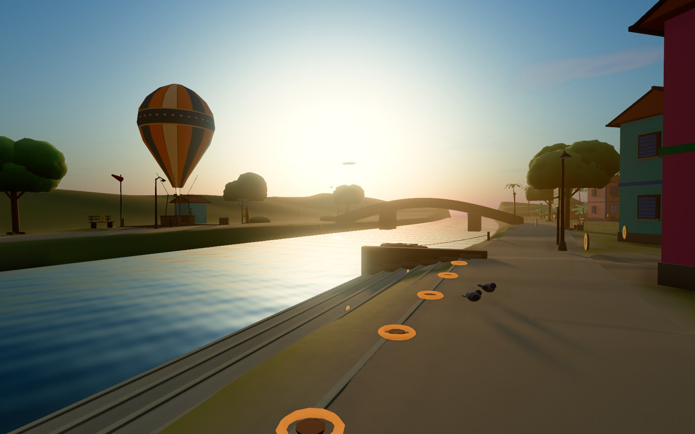
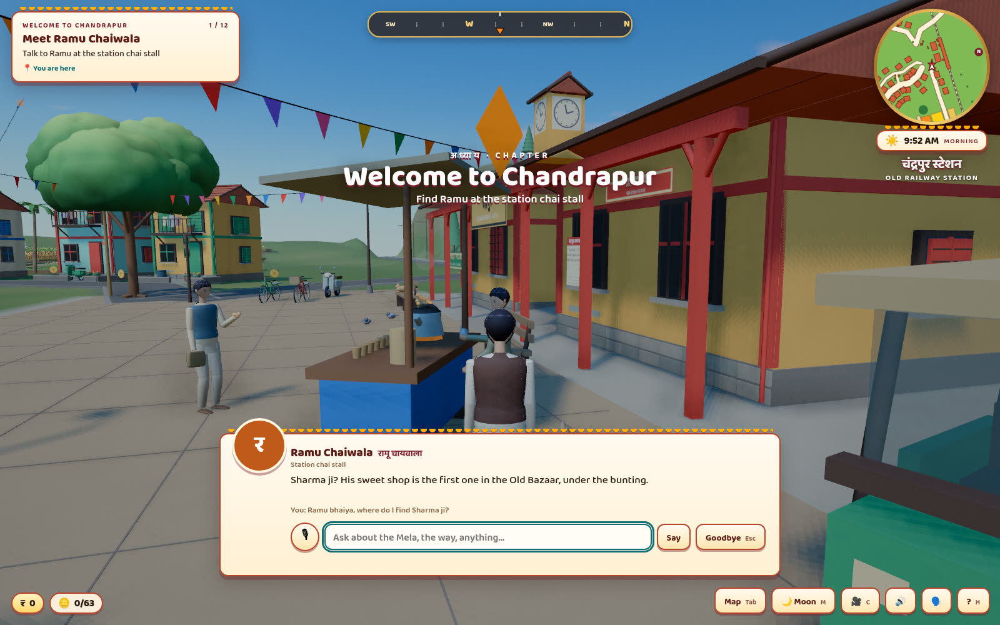
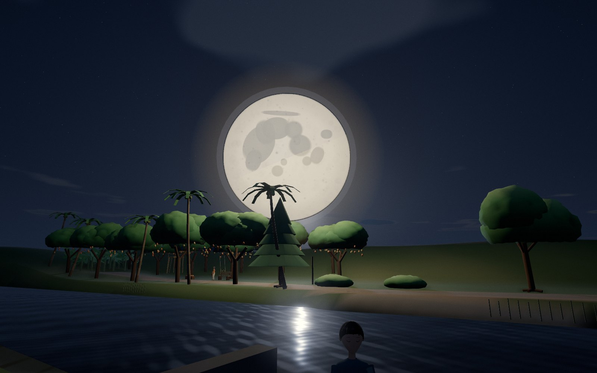
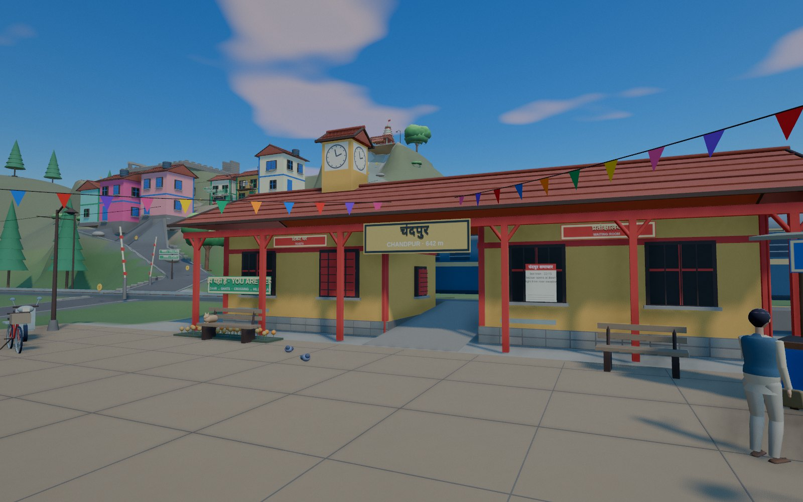
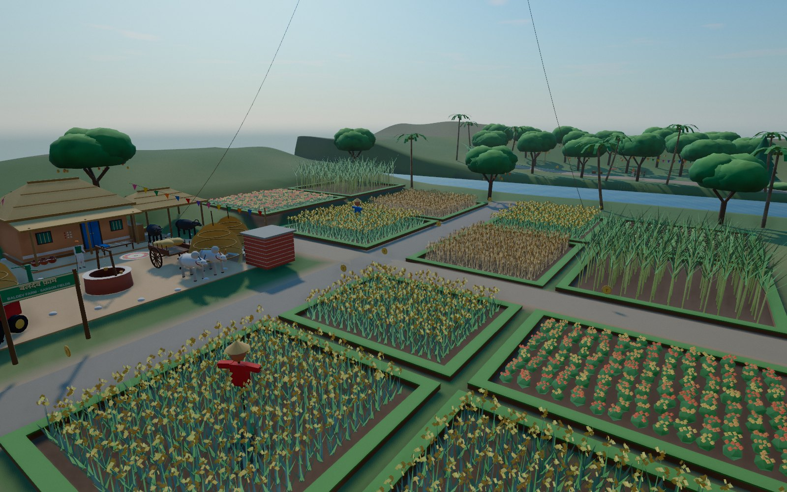
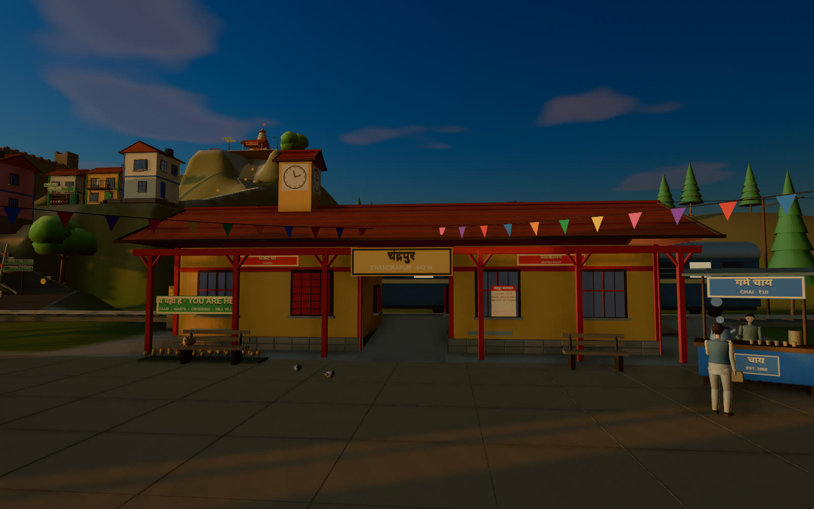
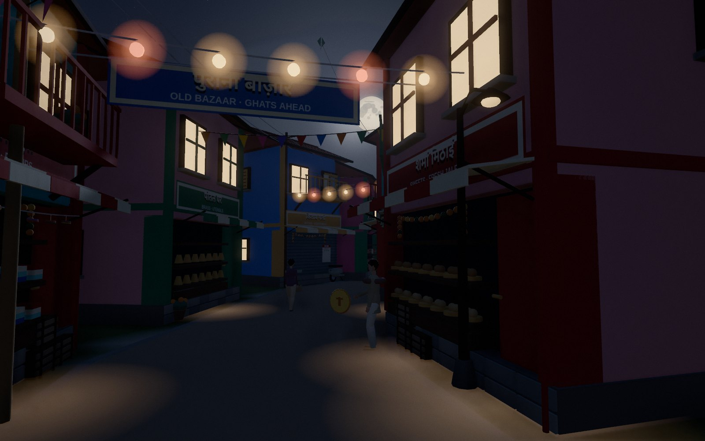

# चंद्रपुर · Chandrapur — Get You the Moon

A harvest-fair day in a little North Indian railway town, built procedurally
in Three.js. Help the villagers get ready for the **Fasal Mela**: gather
marigolds in the mustard fields, carry laddoos to the farmer, pick mangoes
across the river, fly the hot-air balloon, ring the shrine bell at dusk,
light the ghats — and bring down the moon.

- **Villagers who talk back.** Every person in the valley speaks their lines
  aloud in their own voice, and you can stop anyone and *talk* to them, by
  microphone or keyboard. They answer in character, knowing the hour, where
  you are and what you're meant to be doing.
- **A soundtrack made with [ACE-Step](https://github.com/ace-step/ACE-Step).**
  An original Hindi song, *Chanda Utar Aa* (“Moon, Come Down”), plays over the
  finale with synced lyrics, and a bansuri-and-santoor piece scores the day.
- **A realistic atmosphere.** Physically based materials, a physical sky that
  lights the scene, valley haze that matches the horizon, AgX filmic exposure
  through the day, moonlit nights, wind and river ambience.



| | |
|---|---|
|  |  |
|  |  |
|  |  |

```sh
npm install
npm run dev            # http://localhost:5173 — press “Begin the Day”
```

Progress saves automatically (localStorage); **Continue** resumes it.

## Controls

| Input | Action |
| --- | --- |
| WASD / arrows | Walk |
| Shift | Run |
| Space | Jump |
| Mouse (click the world first) / drag | Look around |
| Wheel | Camera distance |
| E | Talk, light a diya, rest on a charpai, ring the bell, board / leave the balloon |
| **T** | **Chat freely with the nearest villager — 🎙 speak, or type** |
| Tab | Valley map |
| M | Bring down / send home the moon |
| C | Cinema (orbit) view |
| H | How to play · reset progress |
| Esc | Leave a conversation · release the cursor · close a panel |

The 🗣️ button turns villager voices on and off; 🔊 toggles music and sound.

## Talking to the villagers

```
 🎙 Web Speech recognition (en-IN)  ─┐
 ⌨  or typed text                   ├─► POST /api/npc ─► GLM-5.3-Flash on GMI Cloud (any OpenAI-compatible model)
                                    │     persona + valley + hour + place + quest + inventory
 🗣  scripted lines ◄── public/audio/voices/*.mp3  (Inworld TTS-2, pre-rendered, directed per villager)
    live replies   ◄── POST /api/tts  (Inworld TTS-2 Flash on GMI, same cast voice, cached)
    no key/server  ◄── the browser's speech synthesis (per-character voice, pitch, pace)
```

- **Who they are** lives in one file, `src/game/characters.js`: name, role,
  personality, idle lines and voice for each of the 12 villagers, plus the
  world brief they all share. The game and the server both read it, so
  Ramu sounds like Ramu in the scripted quest and in free conversation.
- **The brain** (`server/npc-brain.mjs`) runs server-side — as Vite middleware
  in `npm run dev` / `npm run preview`, and in `server/serve.mjs` for
  production — so API keys never reach the browser. It caps input sizes,
  keeps the last 10 turns per villager, rate-limits, and strips reasoning
  tags from models that think out loud.
- **A cast, not a voice.** Each villager has an Inworld voice and an acting
  note in `characters.js`: Ramu is Manoj, Dadaji is Theodore (slow, hoarse,
  storytelling), Chotu is a breathless nine-year-old, the women of the paddies
  are Meher, Riya and Seema, all speaking Indian English (`en-IN`).
- **Every scripted line is pre-rendered** (`npm run voices`, 132 lines, about
  $0.21) into `public/audio/voices/` with a manifest, so quest dialogue plays
  instantly and works even on a static deploy. Free-conversation replies are
  voiced live through `/api/tts` with the faster Flash model, and every
  rendered line is cached on disk (`.cache/voices`) so it's paid for once.
  Without a provider the browser speaks, picking Indian-English or Hindi
  voices where available (Chrome and Edge have the best).
- **Fast enough to feel like talking.** The brain answers in about 1.6 s
  (median); requests that stall are hedged with a second ask after 2.5 s.
- **No key? Still works.** Without an LLM the villagers answer offline from
  their own lines and quest hints (“Where is Munni Didi?” → directions), and
  the music ducks whenever anyone speaks either way.

Configure in `.env` (see `.env.example`). One GMI Cloud key covers both the
brain and the voices:

```sh
GMI_API_KEY=...        GMI_MODEL=zai-org/GLM-5.3-Flash
```

Or point the brain at any OpenAI-compatible endpoint (`LLM_API_KEY`,
`LLM_BASE_URL`, `LLM_MODEL`: OpenAI, OpenRouter, a local Ollama / vLLM `/v1`)
and the voices at `TTS_PROVIDER=openai` (`gpt-4o-mini-tts`).

## The soundtrack (ACE-Step)

Songs are data: `music/songs/<slug>.json` holds the caption (style tags),
lyrics (Devanagari for ACE-Step 1.5, romanized `lyrics_latin` for v1), tempo,
key and length. `tools/acestep.py` renders them on the official ACE-Step
Hugging Face Spaces (ZeroGPU, so no local GPU is needed) and logs every take
with its seed:

```sh
npm run music -- music/songs/chanda-utar-aa.json             # ACE-Step v1 (3.5B)
npm run music -- music/songs/*.json --engine v15 --batch 2   # ACE-Step 1.5 XL turbo; needs HF_TOKEN
```

Takes land in `music/takes/<slug>/` (git-ignored); the chosen one is
loudness-normalised into `public/audio/`. The song's lyric timings were
aligned against the take with Whisper word timestamps
(`public/audio/chanda-utar-aa.lyrics.json`).

| Track | Where it plays |
| --- | --- |
| `chanda-utar-aa.mp3` — *Chanda Utar Aa*, Raag Bhupali folk ballad, female vocal | Moon finale (with Hindi + English lyrics on screen), and ♪ on the title screen |
| `chandrapur-din.mp3` — bansuri, santoor, tabla, tanpura | Daytime, with long quiet gaps between plays, like a film score |
| `ghat-ki-raat.json`, `fasal-mela.json` | Specs ready to render (night alaap; dhol-and-shehnai fair). Until then a generative Raag Bhupali (tanpura, bansuri, tabla in WebAudio) fills the night |

`src/audio/music.js` mixes it all: recorded pieces, the generative raga
between them, wind and river ambience by distance to the water, birds by day,
crickets by night, temple bells and fireworks.

## The valley

| Place | What's there |
| --- | --- |
| Old Railway Station | Chai stall (Ramu), bunting over the forecourt, the night passenger |
| Old Bazaar | Sharma ji's sweet shop, cloth and brass shops, jhandiyan across the lane |
| Sarson Fields (east) | Mustard, wheat, sugarcane, marigold and vegetable plots; Baldev Kaka's thatched farmstead with buffaloes, bullock cart, tractor, tubewell, well, haystacks, kites; Dadaji under the banyan |
| Paddy Fields (west) | Flooded rice terraces with egrets and planters, coconut palms, banana grove, lotus pond, wayside shrine, Ganga Devi's homestead |
| Riverside Ghats | Stone steps, diyas to light, the footbridge |
| Mango Orchard (across the river) | Munni Didi, mango trees, jhoola swing, machan |
| Balloon Landing ↔ Fort Shoulder | Scenic balloon flight (Captain Bhola) |
| Hill Village, Hill Fort, Shrine Hill | Terraced houses, ramparts, the shrine bell |

## Game systems

- **Quests** (`src/game/quests.js`, run by `src/game/game.js`): a 12-step story
  with talk, collect, reach, interact, light-the-diyas and moon steps, rupee
  rewards, district-discovery bonuses and a fireworks finale.
- **People** (`src/game/characters.js`, `src/game/npcs.js`,
  `src/game/conversation.js`): farm folk in pagdis and sarees plus the town's
  residents, all talkable — scripted quest lines, idle chatter, free voice chat.
- **Pickups** (`src/game/pickups.js`): marigolds, mangoes, old rupee coins on
  every lane, an objective marker and fireworks.
- **Day cycle** (`src/world/daycycle.js`, `src/world/sky.js`): about a 12-minute
  day. A Preetham physical sky (with stars and moon glow at night) drives the
  sun's colour, the hemisphere light and a PMREM environment map that is
  rebuilt only when the sun has moved; fog, windows, lamp glows, river colour
  and exposure all follow the hour.
- **Rendering** (`src/core/toon.js`, `src/core/post.js`, `src/core/renderer.js`,
  `src/world/river.js`): `MeshStandardMaterial` everywhere with surface presets
  (plaster, earth, wood, cloth, foliage, metal, water…) and subtle world-space
  weathering; height-aware fog thicker in the valley; HDR pipeline with
  half-res ambient occlusion, bloom on bright sources only, a glare veil
  toward the sun or moon, AgX tone mapping, vignette and grain; silty
  reflective river water.
- **Farms** (`src/world/farm-kit.js`, `src/world/districts/farms.js`):
  instanced crops swaying in a shared breeze, terraced plots cut into the
  terrain (`FARM_PLOTS` in `src/world/layout.js`).
- **HUD** (`src/ui/game-hud.js`): quest card, compass, rotating minimap, clock,
  wallet, dialogue and chat, lyric captions, banners, title screen, help and map.

## Running in production

```sh
npm run build
npm start              # server/serve.mjs: dist/ + the villager API on :8080 (PORT=...)
```

Served as plain static files (any CDN), the game still runs; villagers fall
back to offline answers and browser voices.

## Verification

```sh
npm run test:voice     # stand-in LLM + TTS: walk to Ramu, T, ask; reply, context, pre-rendered + live voice, stall hedging, offline fallback
npm run test:audio     # ACE-Step day piece, night fallback, song + lyric captions on the moon finale
npm run test:town      # (dev server on :5173) connectivity, walking, balloon, life, HUD
node agent/playtest.mjs <out-dir> [--from <step>]   # drives the quest chain with screenshots
node agent/game-shots.mjs <out-dir> [--time 0.38]   # daytime captures of each district
npm run build
```

`WORLD_DESIGN.md` records the original town-design principles.

## Credits

Music generated with [ACE-Step](https://github.com/ace-step/ACE-Step)
(Apache-2.0) via its official Hugging Face Spaces; lyrics written for this
project. Villager voices by Inworld TTS-2 via [GMI Cloud](https://www.gmicloud.ai/).
People, foliage and creature techniques adapted from
[Sakuragaoka Station](https://github.com/Kenton-GMI/sakuragaoka-station) (MIT).
Built with [three.js](https://threejs.org/) and Vite. MIT licensed, see `LICENSE`.
